# dwelld.

**Your room remembers.**

Moving into a place? Give it a quick scan so you have a record of what was already there. Moving out? Pull up the earlier inspection and compare. Dwelld keeps room walkthroughs, visible damage, furniture and supporting evidence together, so you can check and correct what the AI found instead of relying on memory.

You can upload a video or pair a LiDAR-capable iPhone for a measured 3D room. Dwelld then helps you review observations, place or move damage markers, search your records, and export a report. **You stay in charge of confirming findings:** AI can miss things and an inspection alone cannot decide who caused damage.

This README reflects the source as of **25 October 2026**. Some older `docs/` files record earlier designs or one-off tests; when they differ, current code takes precedence.

## Contents

- [Features and limitations](#features-and-limitations)
- [Requirements met](#requirements-met)
- [3D loading and performance](#3d-loading-and-performance)
- [System architecture](#system-architecture)
- [Repository layout](#repository-layout)
- [Requirements and setup](#requirements-and-setup)
- [Environment variables](#environment-variables)
- [Capture and analysis](#capture-and-analysis)
- [Persistence and media](#persistence-and-media)
- [Authentication and authorization](#authentication-and-authorization)
- [Search and questions about records](#search-and-questions-about-records)
- [Evidence seal (tamper-evident ledger)](#evidence-seal-tamper-evident-ledger)
- [Comparisons and reports](#comparisons-and-reports)
- [Pages and APIs](#pages-and-apis)
- [Deployment and operations](#deployment-and-operations)
- [Verification and troubleshooting](#verification-and-troubleshooting)
- [Models, licensing, and documentation](#models-licensing-and-documentation)

## Features and limitations

| Area | Implemented behavior |
| --- | --- |
| Accounts | Better Auth email/password accounts and owner-scoped records. |
| Spaces and sharing | Group rooms under a Space (a property). Invite a tenant or landlord with an email-bound, seven-day, one-use link; members get read access to shared rooms and can run their own inspections. |
| Rooms | Create/rename rooms and reopen inspection history. |
| Video inspection | Upload recordings, detect furniture/fixtures on sampled frames, and save damage observations with timestamped evidence. |
| Native capture | SwiftUI companion uses RoomPlan/ARKit for measured elements, calibrated imagery, and available scene depth/confidence. |
| Pairing | A signed-in owner creates a laptop session; a QR handoff opens the native companion. |
| Spatial review | Three.js measured geometry, Gaussian preview/reconstruction, evidence-linked markers, and marker editing. |
| Verification | A second, adversarial Gemini 4 Argon pass tries to reject every finding: auto-confirm at 85%, auto-dismiss "not damage" at 60%, everything else waits for a person. |
| Human review | Confirm/reject/reset observations, preserve review history, and add manual damage evidence. |
| Continue a scan | The phone saves an ARWorldMap; "Continue this scan" relocalizes into it, so new frames land in the original coordinates. |
| Comparison | Review candidate correspondences and visible changes between earlier and later inspections of the same room. |
| Evidence seal | Every saved scan's files are SHA-256 fingerprinted into a hash chain signed with Ed25519; reports re-verify it live. |
| Retrieval | Atlas Search, Automated Embedding, Voyage photo vectors and `$rankFusion` hybrid search; source-cited answers about saved records. |
| Argon chat | A movable per-scan chat answers questions about a room and its findings with inline evidence and video timestamps, and can explain or retry a stuck scan. |
| Export | Structured JSON and browser print/save-to-PDF reports. |

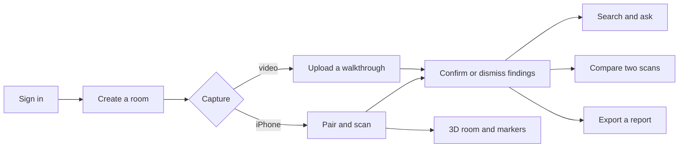

AI observations require review. A missing detection or completed analysis does not establish absence of damage. A confirmed finding records a user's review decision; it does not determine liability, structural safety, or repair cost. A brand-new RoomPlan scan has its own origin and is not automatically registered to an older one; use **Continue this scan** to relocalize into the earlier scan's coordinates.

The repository retains browser WebRTC capture/signalling infrastructure, but the **current public QR pages open the native LiDAR companion only**. They no longer expose the earlier browser-phone recording fallback. Uploaded video remains a separate web capture option.

## Requirements met

Encode London 2026, MongoDB bounty: an app that solves a real problem with **MongoDB Atlas as its foundational data store**. Extra points come from Atlas Search, Atlas Vector Search, Hybrid Search, Automated Embedding, Atlas Stream Processing and Voyage AI. The copied brief is in [docs/BOUNTY-REQUIREMENTS.md](docs/BOUNTY-REQUIREMENTS.md).

Dwelld meets that bar. Atlas is the only database. Rooms, inspections, findings, live sessions and accounts live there, and the original video, photos, depth and splats are stored in GridFS. A saved video inspection writes those records, then prepares the finding text and vectors so the same documents can be searched.

| Atlas feature | Met | Where it is used |
| --- | --- | --- |
| Foundational data store | Yes | `MONGODB_URI`. Rooms, inspections, findings, sessions and auth. Media in GridFS. |
| Atlas Search | Yes | `$search` on `findings_search`: fuzzy match on label, description and damage type. |
| Atlas Vector Search | Yes | `$vectorSearch` on `findings_vector` (Gemini, 768 dimensions) and `findings_image` (Voyage photo vectors, 1024 dimensions). |
| Hybrid Search | Yes | One `$rankFusion` stage over keyword, meaning and photo results. On a cluster below MongoDB 8.0 the same fusion runs in the app, and the search page says so. |
| Automated Embedding | Yes | `findings_auto` embeds `searchText` with Voyage `voyage-4` when a finding is written and when a query is run. |
| Voyage AI | Yes | `voyage-4` through Automated Embedding, `voyage-multimodal-3.5` for evidence photos, and `rerank-3` after fusion. Photo search and rerank need `VOYAGE_API_KEY`. |
| Atlas Stream Processing | No | Not used. |

The damage check itself stores evidence in Atlas. Atlas Search, Vector Search, hybrid search, Automated Embedding and Voyage run when those saved findings are prepared and someone searches or asks about them. Search returns an error until the indexes are queryable. There is no regex substitute. The submission still needs the repository link and a 3-minute demo that shows the app and MongoDB in use.

## 3D loading and performance

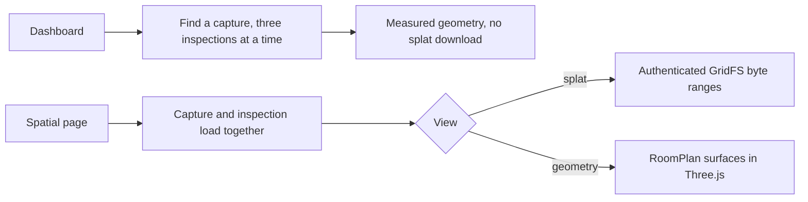

The dashboard now checks possible captures in parallel batches of three, rather than waiting for each inspection in turn. Its small room preview starts with lightweight measured geometry, so it does **not** need to download and decode the larger Gaussian PLY just to show a room. Open an inspection's spatial page to see the full reconstruction or switch to geometry. That page also requests the capture and inspection details in parallel.

These changes shorten avoidable wait paths; they are **not** a measured end-to-end speed claim. Full PLY loading still depends on file size, network speed, decoding and the device's GPU. Private spatial files are served through authenticated GridFS routes with byte-range support and `no-store` caching. For outstanding work, benchmarks and the Encode partner/submission review, see [the performance and hackathon audit](docs/hackathon-performance-audit-2026.md).

## System architecture

The web application is a **Next.js App Router application** with React client interfaces and Node.js route handlers. The iOS companion is a separate client of the same HTTPS backend. MongoDB Atlas stores both records and binary media through GridFS. There is no separate worker server, WebSocket service, or hosted GPU trainer in this repository.

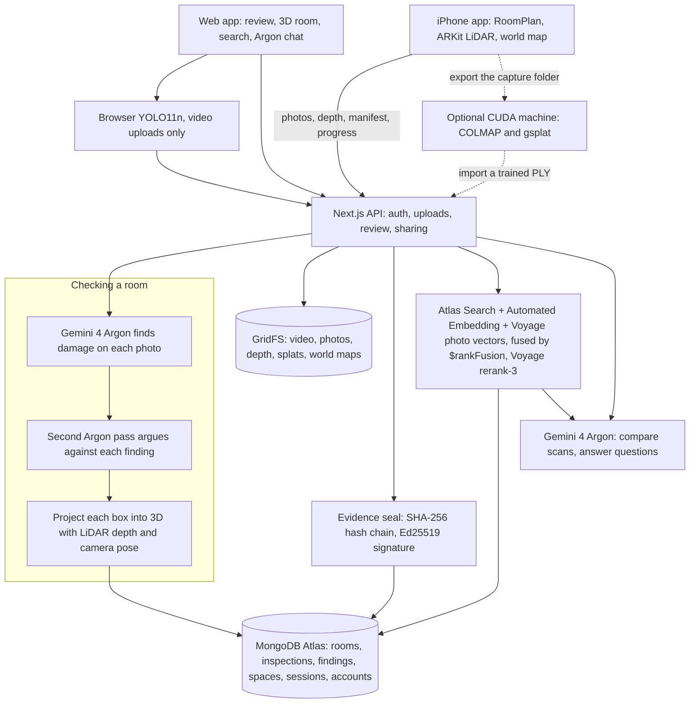

How to read it:

- An uploaded video is sampled every second in the browser, up to 121 frames. YOLO names the furniture. The server extracts those same seconds with FFmpeg. Gemini 4 Argon checks each photo for damage.
- A paired iPhone scan sends the measured room, photos and LiDAR depth during the walk. Argon inspects each photo, then a second Argon pass (`thinking_level` medium) tries to reject each suggestion. Two database leases keep that work to two photos at a time.
- A capture manifest saved without the live session is the path that runs YOLO on the server. It samples the first, middle, and last frame, then Argon.
- When a scan is saved, every evidence file is fingerprinted and the inspection is sealed into the signed ledger (`lib/server/ledger.ts`).
- Argon also compares two inspections (`thinking_level` high, in parallel batches), answers questions in Ask Records and the per-scan chat, and describes damage a person marks by hand. Embeddings come from Atlas Automated Embedding (Voyage `voyage-4`), Voyage `voyage-multimodal-3.5` for photos, and `gemini-embedding-001` as a fallback. The dotted line is a manual export to a separate computer, not a service the app calls. QR pairing opens the iPhone app; retained browser WebRTC is not how a scan is uploaded.

Chairs, sofas and beds use the same damage rules as tables, cabinets and doors. Cushion creases, fabric weave and bedding are left out. A direct import checks up to four detected objects, one kind first. A not-damage verdict at 60 percent verifier confidence or more is dismissed and can be undone. Clear damage still auto-approves at 85 percent.

### Layers and responsibilities

| Layer | Technology | Responsibility |
| --- | --- | --- |
| Web UI | Next.js 15, React 19, TypeScript | Dashboard, capture, history, review, comparisons, reports. |
| Styling | CSS, Tailwind CSS 3, Lucide | Shared visual system and icons. |
| API | Next.js route handlers, Node.js | Authorization, validation, uploads, analysis orchestration, persistence. |
| Authentication | Better Auth + MongoDB adapter | Password accounts and cookie sessions. |
| Storage | MongoDB driver 7, Atlas, GridFS | Structured records and private original/evidence bytes. |
| Browser inference | YOLO11n, ONNX Runtime Web | Object detection for an uploaded video, in the browser, on CPU/WASM. |
| Server processing | FFmpeg, Sharp, ONNX Runtime Node | Video frame extraction, image crops, server YOLO for a direct capture import. |
| Generative AI | `@google/genai` | Damage observations, supplemental furniture, comparison, embeddings, answers. |
| Spatial display | Three.js, GaussianSplats3D | Measured room geometry, splats, spatial annotations. |
| Native app | SwiftUI, RoomPlan, ARKit, Metal | LiDAR capture, calibrated evidence, depth-based Gaussian preview, upload. |
| Hosting/analytics | Vercel-compatible Next.js, Vercel Analytics | UI and functions; analytics mounted in the root layout. |
| Optional reconstruction | Python, COLMAP, pinned gsplat | Offline trained Gaussian reconstruction on a separate CUDA workstation. |

Versions above describe dependency families in `package.json`; `package-lock.json` pins the installed graph.

### Execution model

`app/api/` contains HTTP orchestration. Reusable services live in `lib/server/`, while browser inference, uploads, tracking, and signalling live in `lib/client/`. Shared contracts are in `lib/types.ts`, `lib/live/`, and `lib/spatial/`.

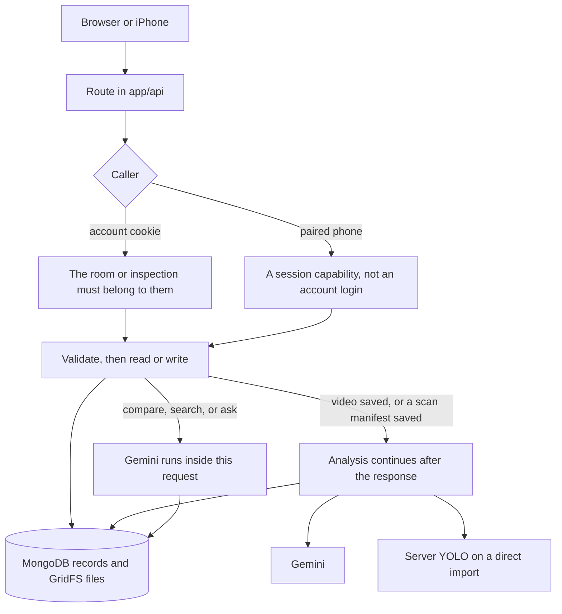

A video inspection and a saved scan return their id first, then keep analysing inside that function. Process termination can leave that work unfinished. There is no separate job queue. Comparison, search, and Ask run inside the request that started them. Comparison takes a database lease so one owner and room run one comparison at a time.

## Repository layout

```text
app/
  api/
    auth/[...all]/               Better Auth handler
    spaces/, invites/            Spaces (properties), members, invitation links
    rooms/                       Rooms and confirmed correspondences
    inspections/                 Findings, video, report, seal, retries, room boundaries, spatial capture
    spatial/inspections/         Create a native-only inspection
    live/                        Pairing, signals, events, frames, marks, uploads, world map, analysis
    comparisons/                 Move-in vs move-out comparison and review
    uploads/, media/             Chunked upload and private GridFS streaming (byte ranges)
    search/                      Search, index setup/prepare, vector-space explorer
    ask/, scan-chat/             Ask Records and the per-scan Argon chat
    scan-recovery/               Find and resume unfinished scans
    ledger/key/                  Public Ed25519 key for seal verification
    diagnostics/ai/              Model reachability check
  spaces/[spaceId]/              Space overview
  rooms/[roomId]/                Room history; compare/ for move-in vs move-out
  inspections/[inspectionId]/    Inspection review; spatial/ and report/ pages
  live/                          Capture workspace and session page
  search/                        Atlas search lab
  connect/, scan/                Native QR handoff (scan is a legacy URL)
  invite/, sign-in/, profile/    Invitation acceptance and account UI
components/                      Dashboard, capture, review, comparison, search, spatial, chat UI
  live/                          Live scan workspace, feed and batches
lib/
  auth.ts, auth-client.ts, auth-origins.ts   Server/client auth configuration
  api.ts, types.ts               API client and record contracts
  comparison*.ts, damage-identity.ts, inspection-timeline.ts, processing-workflow.ts,
  scan-recovery.ts, video-sampling.ts        Shared logic used by client and server
  client/                        Browser YOLO, tracking, chunked uploads, signalling, playback
  server/                        Database, media, analysis, verification,
                                 comparison batches, search pipelines, Voyage, ledger, access
  live/                          Session and analysis contracts
  spatial/                       Manifest types, room boundaries, identity, reconstruction
ios/                             Xcode project and SwiftUI LiDAR companion (DwelldCapture)
public/models/                   yolo11n.onnx (YOLO11n weights), provenance, license
public/onnx/                     Browser ONNX runtime assets and notices
scripts/
  setup-search-indexes.cjs       Submit the four Atlas Search / Vector Search indexes
  assign-legacy-owner.cjs        Audited legacy ownership migration
  spatial/                       Offline reconstruction wrapper
  vercel/, verify-*.{py,sh}      Build skipping and native-build checks
tests/                           Node regression suite (node --test)
docs/                            Feature guides, audits and historical verification
```

## Requirements and setup

- Node.js **20.19+** or a newer compatible release, and npm. The MongoDB driver's engine requirement is stricter than a generic Node 20 minimum.
- MongoDB Atlas access. Search/Vector Search support is needed for retrieval; comparison review and legacy migration use transactions.
- A Google Gen AI key with access to the configured generation model and, for semantic retrieval, `gemini-embedding-001`.
- A modern browser with WebAssembly and video decoding support. Browser camera code requires permission and a secure context such as HTTPS or localhost.
- Native capture: Xcode, Apple signing, and a physical LiDAR-capable iPhone/iPad running iOS 17+. Simulator builds do not verify sensor capture.
- Optional trained reconstruction: a separate CUDA workstation with dependencies from the [reconstruction guide](scripts/spatial/README.md).

```sh
npm ci
cp .env.example .env.local
openssl rand -base64 32
```

Populate `.env.local`, using the generated value as `BETTER_AUTH_SECRET`. Start on port 3001 to match the authentication example:

```sh
npm run dev -- --port 3001
```

Open [localhost:3001](http://localhost:3001), create an account and room, then start a capture or upload. To use port 3000, set `BETTER_AUTH_URL=http://localhost:3000` and run `npm run dev`.

For a local production build:

```sh
npm run build
npm run start -- --port 3001
```

### Atlas configuration

1. Create a database user and allow network access from development/hosting environments.
2. Set `MONGODB_URI` and `MONGODB_DB`. URL-encode special characters in the database password.
3. Core/auth/upload/live indexes are created by their respective services. Atlas Search indexes require a separate setup step.
4. Submit current search definitions using a user with index-management privileges:

   ```sh
   node --env-file=.env.local scripts/setup-search-indexes.cjs
   ```

5. Wait until all four indexes (`findings_search`, `findings_auto`, `findings_vector`, `findings_image`) are queryable in Atlas. Index submission and propagation are asynchronous. The **Create or update indexes** button on `/search` does the same thing.

Use the setup script as the current index definition, including ownership filters; older search documents may describe previous mappings.

## Environment variables

Keep secrets in ignored environment files or deployment configuration. Gemini/MongoDB/auth secrets remain server-side and must not use `NEXT_PUBLIC_` names. **No Vercel Blob credentials are required.**

| Variable | Requirement | Purpose/default |
| --- | --- | --- |
| `MONGODB_URI` | Required | Records, authentication, live state, and GridFS connection. |
| `MONGODB_DB` | Optional | Database name; defaults to `dwelld`. |
| `BETTER_AUTH_SECRET` | Required | Random secret of at least 32 characters. |
| `BETTER_AUTH_URL` | Configure per environment | Exact origin, including local port; example uses `http://localhost:3001`. |
| `GEMINI_API_KEY` | AI features | Server-side generation and embedding credential. |
| `VOYAGE_API_KEY` | Photo search, rerank | Voyage AI by MongoDB model API key (Atlas UI → AI Models). Used against `https://ai.mongodb.com/v1` (`VOYAGE_BASE_URL` to change). Automated Embedding needs no key here. |
| `LEDGER_SECRET` | Optional | Secret for the evidence seal's Ed25519 signing key (32+ characters). Defaults to `BETTER_AUTH_SECRET`; changing it means new seals use a new key. |
| `ATLAS_AUTO_EMBED_MODEL` | Optional | Model for the `findings_auto` autoEmbed index, default `voyage-4`. |
| `GEMINI_VERIFY_MODEL` | Optional override | Model for the adversarial verification pass; defaults to `GEMINI_MODEL`. |
| `AUTO_APPROVE_THRESHOLD` | Optional | Verifier confidence that auto-confirms a finding, default `0.85`. |
| `GEMINI_MODEL` | Optional override | Generation model; source/example default is `gemini-4-argon`. Verify access in your project; a configured identifier does not establish availability. |
| `TURN_URLS` | Optional WebRTC path | Comma-separated `turn:`/`turns:` endpoints. |
| `TURN_SHARED_SECRET` | Optional WebRTC path | TURN REST HMAC secret for a compatible provider. |
| `DWELLD_DIST_DIR` | Optional | Next.js output directory, default `.next`; useful for separate development/build outputs. |

The embedding model and 768 dimensions are defined in `lib/server/search.ts`, not an environment variable. Changing them requires compatible stored vectors and Atlas index configuration.

## Capture and analysis

### Uploaded video

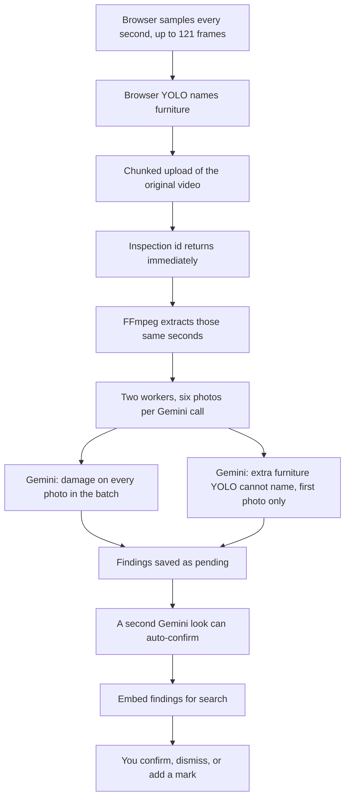

1. The browser samples at one-second intervals, including the beginning and end (up to 121 images for a two-minute video). Nearby object observations use the live tracker to reduce repeated inventory entries.
2. YOLO applies 640×640 letterboxing and class-aware non-maximum suppression, then maps boxes to normalized source coordinates. Browser detections are validated; this path does not independently rerun server YOLO against the uploaded recording.
3. The server independently selects one-second timestamps, including for older clients that submitted only three frames. FFmpeg extracts original-resolution PNGs using accurate input seeking. Byte-identical photos are deduplicated by hash.
4. Gemini checks every selected photo for damage on all visible furniture, fixtures and room surfaces. Requests contain up to six timestamped photos, with at most two batches in flight. Missing, duplicated or invented response timestamps fail validation. Each box belongs to its exact source photo.
5. YOLO supplies the main video inventory. One supplementary furniture check per batch preserves Gemini-assisted observations for categories YOLO does not support.
6. Findings and evidence are saved with review status `pending`; a bounded second look can auto-confirm findings. Embeddings are indexed in a bounded batch; failed indexing can be resumed separately.

The working analysis budget is approximately 240 seconds within a route declaring `maxDuration=300`. Batch requests have 60-second timeouts. Unchecked batches or failed services produce explicit warnings and `partial` status; a partial inspection is not evidence that unassessed views are undamaged.

Supported YOLO room classes are chair, couch, potted plant, bed, dining table, toilet, TV, laptop, microwave, oven, toaster, sink, refrigerator, clock, and vase. It is not open-vocabulary inventory. Repeated video views do not establish stable physical identity.

### Native LiDAR capture

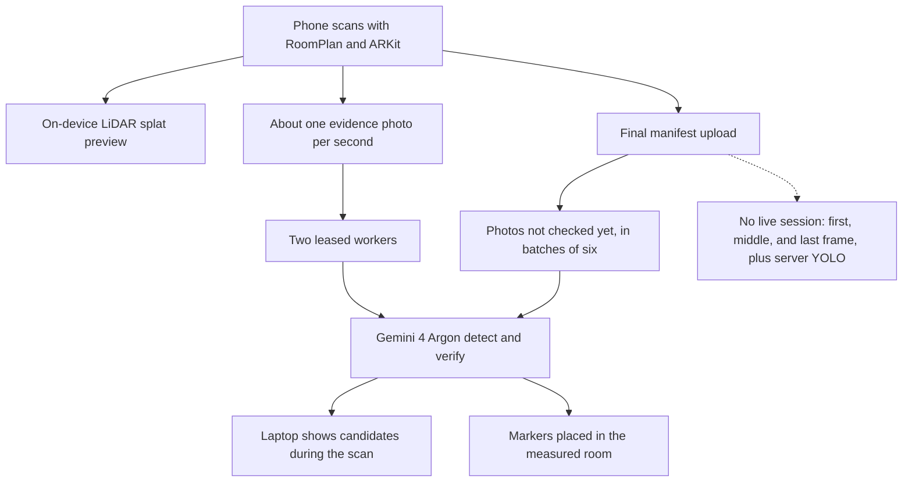

The companion can scan locally before sign-in. Direct upload uses a web-account cookie acquired through its embedded browser and requires an owned room. Paired upload instead uses a scoped phone capability from a laptop session.

1. RoomPlan captures element UUIDs, dimensions, transforms, and a local USDZ. ARKit captures RGB frames, intrinsics, camera poses, and depth/confidence when available, at up to roughly 2 Hz and 240 frames over a scan bounded to 120 seconds.
2. The compact path builds an **untrained LiDAR-initialized Gaussian preview** from measured high-confidence depth. Samples deduplicate into 2.5 cm world voxels with a 150,000-splat cap. An on-device Metal preview renders up to 40,000 accumulated samples.
3. Paired compact upload sends the preview PLY, roughly one resized RGB evidence photo per second plus up to sixteen extra coverage views, sparse depth/confidence assets, and a manifest. Up to four assets upload concurrently, each with sequential chunks; completed references persist for retry.
4. The backend validates the manifest and asset ownership. Paired assets must also belong to the session. Reposting the same saved manifest is idempotent; replacing it with a different scan is rejected.
5. Paired native analysis inspects whole photos even before RoomPlan recognizes furniture, publishes candidates before verification, and checks them with a second, adversarial Argon pass. Two database-leased live workers prioritize recent queued views. Saving reuses completed live checks and analyses remaining photos in batches of six, with explicit warnings for failed/unassessed photos. The older standalone spatial-import service still samples first/middle/last frames.
6. High-confidence depth projects evidence into world coordinates. Compatible RoomPlan elements can group object observations within the scan; unresolved identity stays explicit. Marker creation preserves existing user edits.

World coordinates are ARKit right-handed, Y-up, in metres; matrices are column-major. Depth is little-endian float32 metres and confidence is uint8 0–2. Camera intrinsics must match encoded image dimensions. Stored registration does not itself prove good alignment.

**Compact upload does not back up the complete capture folder.** Full-resolution imagery, original depth/confidence, USDZ, and `original-manifest.json` remain in the app's Documents directory. Export the folder before uninstalling/deleting captures. Reopening saved capture folders after app restart is not yet implemented.

The Gaussian preview may contain gaps, blur, drift, and colour seams. Without usable depth the app retains measured geometry instead of inventing splats. A trained PLY with matching registration can later replace the initialized preview while retaining reconstruction history. Actual training requires the separate [offline workflow](scripts/spatial/README.md), not Vercel.

### Pairing and retained live infrastructure

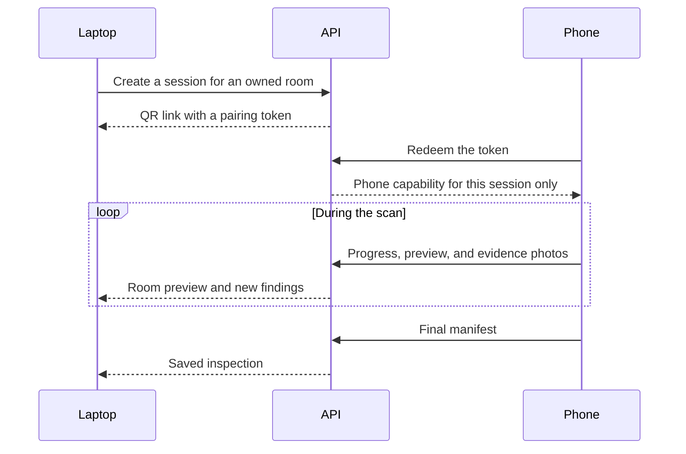

`POST /api/live` checks the owner's room and creates a two-hour session with separate desktop and pairing capabilities. Pairing expires after ten minutes. MongoDB stores capability hashes; atomic claiming prevents a second phone from redeeming the pairing.

QR links use `/connect/[sessionId]` with the pairing token in the URL fragment. That page and legacy `/scan/[sessionId]` open `dwelld://pair`. The native companion sends refreshed JPEG previews and measured capture progress about every two seconds; this is not a native WebRTC stream.

`lib/native-distribution.ts` currently exports a null installer URL. A signed build must already be installed through Xcode. A real TestFlight/App Store link and production universal links remain distribution work. The handoff's 3.5-second fallback timer is not reliable installed-app detection. See [native installation handoff](docs/native-install-handoff.md).

The retained browser implementation uses direct WebRTC video/data, HTTP-polled MongoDB signalling, role-scoped bearer capabilities, idempotent event IDs, and negotiation generations. Phone sends offers; desktop sends answers. STUN is configured by default; restrictive networks may require compatible TURN credentials. Native previews do not depend on this relay path.

Live image analysis accepts at most four objects and a 3 MiB image, allows one AI request per session at a time, and applies a 15-second cooldown. Manual evidence has an independent lease and does not call Gemini. Browser-recording finalization waits for analysis/manual leases, requires saved original footage, and uses stable IDs for repeated finish requests. Native capture finalizes through its spatial-manifest endpoint instead.

## Persistence and media

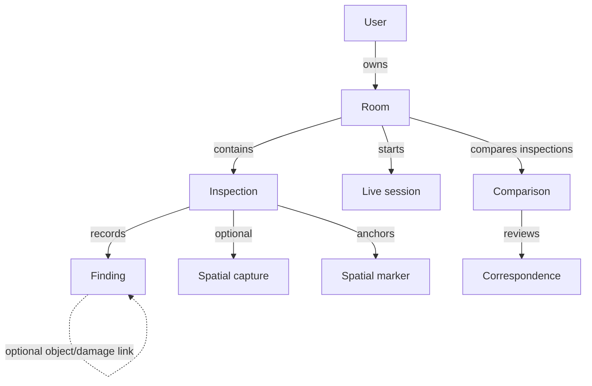

These are logical relationships, enforced by application validation rather than relational foreign keys.

| Collection/group | Main contents |
| --- | --- |
| `user`, `session`, `account`, auth-managed collections | Better Auth identities, accounts/password hashes, sessions, rate-limit data. |
| `rooms` | Owner, name, timestamps. |
| `inspections` | Owner/room, move-in/move-out type, capture/source metadata, status, warnings, duration, timestamps. |
| `findings` | Object/damage kind, description, timestamp, evidence, normalized box/point, parent object, provenance, reviews/history, optional embedding/spatial observations. |
| `spatialCaptures` | One manifest per inspection; elements, calibrated frames, assets, reconstruction registration/history. |
| `spatialMarkers` | World positions, finding/element links, review history, optimistic version, soft deletion. |
| `comparisons` | Baseline/current evidence, candidates, model/prompt version, evidence hashes, warnings, reviews. |
| `observationCorrespondences` | Revocable links activated by confirmed comparison reviews. |
| `comparisonLeases` | Application lease serializing comparisons per owner/room. |
| `liveSessions`, `liveSignals`, `liveEvents` | Pairing/status/capability hashes, recipient-scoped signals, idempotent events. |
| `liveObjects`, `liveFindings`, `liveAnalyses`, `liveEvidence` | Tracking observations, reviews, analysis results, session evidence. |
| `mediaUploads`, `mediaUploadParts` | Temporary upload descriptors/parts, digests, locks, expiry. |
| `media.files`, `media.chunks` | GridFS metadata and binary media. |
| `ownershipMigrations` | Explicit ownership migration audit, including affected records and counts. |

Inspection states are `queued`, `processing`, `completed`, `partial`, and `failed`. Persisted reviews use `pending`, `confirmed`, and `rejected`; internal analyzer output is normalized when persisted. Live session states are `pairing`, `connected`, `recording`, `stopping`, and `saved`.

### Upload and retention

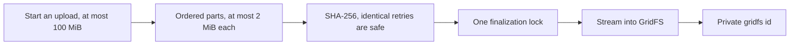

Media references use `gridfs:<ObjectId>`. Uploads accept files up to **100 MiB**, split into sequential HTTP parts of at most **2 MiB**. Parts are insert-only, SHA-256 checked, and idempotent for identical retries. Finalization acquires a recoverable lock and streams validated parts into GridFS. GridFS uses 255 KiB storage chunks independently of upload-part size.

Upload descriptors/parts expire after 24 hours using TTL indexes. Signalling has TTL cleanup. Session expiry does not delete completed inspections. Original media/evidence have no general automatic retention or deletion workflow; expiring temporary records does not garbage-collect completed GridFS files.

Media routes authorize access before streaming, use `private, no-store`, and support single HTTP byte ranges for playback. Saved inspection/report evidence requires an account session; live media requires the appropriate capability and session association. Earlier external Blob assets are not automatically migrated or deleted. **MongoDB/GridFS is the active storage architecture.**

## Authentication and authorization

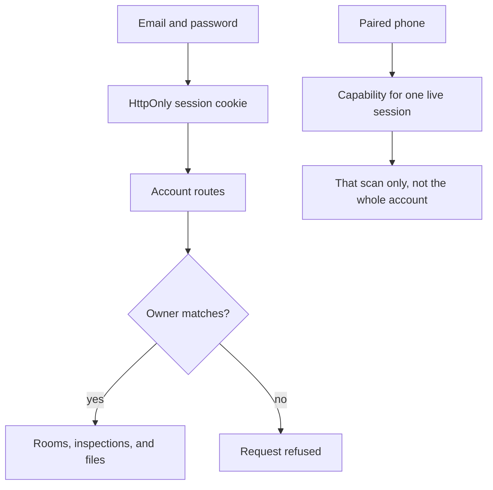

Better Auth stores accounts/sessions in the same database. Passwords must contain 12–128 characters. Sessions expire after seven days and update after one day; authentication rate limiting uses database storage. Session cookies are HttpOnly.

`lib/server/access.ts` centralizes signed-in access and owned room/inspection lookups. Account mutations reject cross-site Fetch Metadata and mismatched origins when supplied. Routes using `readJsonBody` enforce JSON content type, object shape, and streaming byte limits; binary/multipart routes have separate validation.

A GridFS reference is not a public-access credential. Native phone capabilities are scoped to the owner's live session and do not create a general account session.

Email verification and password-reset email delivery are not configured. Sign-up does not establish mailbox ownership. Ownerless historical demo records remain inaccessible and are never assigned automatically during signup.

To inspect an explicit migration dry run:

```sh
node --env-file=.env.local scripts/assign-legacy-owner.cjs --owner-id <existing-user-id>
```

Optionally add `--room-id <legacy-room-id>`. Only after auditing intended ownership, rerun with `--apply`. The script validates the user and conflicting ownership, then transactionally assigns ownerless rooms, inspections, findings, and referenced GridFS metadata with an audit record. It does not claim orphan files or live capabilities.

## Search and questions about records

All search runs inside MongoDB Atlas on the `findings` collection. Open **/search** (the "Search" link in the header) to watch it work: index status, each pipeline's own ranking, the fused result and a map of vector space.

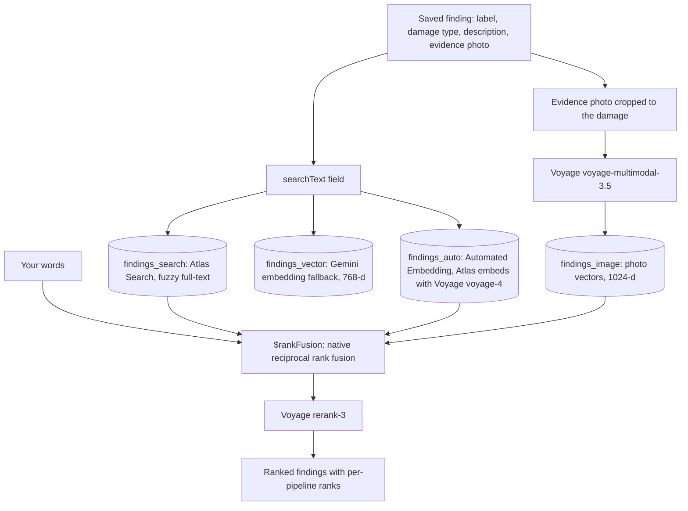

| Mode | Atlas feature | Implementation |
| --- | --- | --- |
| `text` | **Atlas Search** | `$search` on `findings_search`: fuzzy match on label, description and damage type, owner and room filters. |
| `semantic` | **Automated Embedding** (Vector Search) | `$vectorSearch` on `findings_auto` with `query: {text}`. Atlas embeds `searchText` on write and the query at query time with `voyage-4`. Falls back to `findings_vector` (Gemini vectors) while the autoEmbed index is not ready. |
| `image` | **Vector Search + Voyage AI** | The text query is embedded with `voyage-multimodal-3.5` and matched against photo vectors in `findings_image`. Words find photos even when no description mentions them. |
| `hybrid` | **Hybrid Search** | One `$rankFusion` stage over all three pipelines (weights keyword 1, meaning 1, photo 0.8) with `scoreDetails`, then **Voyage `rerank-3`**. If the cluster rejects `$rankFusion` (MongoDB below 8.0), the same RRF formula runs in the app and the page says so. |

Setup: create the four indexes with the **Create or update indexes** button on /search (`POST /api/search/setup?action=indexes`) or `node --env-file=.env scripts/setup-search-indexes.cjs`. Then **Prepare my findings** (`POST /api/search/setup?action=prepare`) writes `searchText`, Gemini vectors and, when `VOYAGE_API_KEY` is set, photo vectors. Analyses also prepare new findings automatically. Search refuses to run against an index that isn't queryable; there is no silent regex fallback.

The global Ask Records interface supplies Gemini with up to 12 recent inspection summaries and 12 hybrid-retrieved findings. The API validates citation IDs and links sources back to inspections. If retrieval fails, it explicitly warns that only recent summaries were supplied. Answers are bounded retrieval samples, not exhaustive history or new image analysis.

## Evidence seal (tamper-evident ledger)

Dwelld uses **SHA-256 file fingerprints, a chained ledger and Ed25519 signatures** to detect changes to saved evidence. This lets a reviewer check whether sealed files still match the recorded originals. It does **not** guarantee that a scene, photo or video was genuine before it reached the server.

### How file fingerprints and seals work

1. **Hash the stored bytes.** Save routes schedule sealing after saving an inspection or updating its capture/evidence. The server gathers referenced GridFS media: the walkthrough recording, evidence frames, spatial capture assets (including photos, depth and splats), and finding photos. Each available file is streamed through SHA-256 on the server. Its manifest entry records `ref`, `name`, `kind`, `sha256` and `bytes`. A SHA-256 fingerprint is a 256-bit digest represented as 64 hexadecimal characters; changing even one byte is overwhelmingly likely to produce a different digest. This is an exact-byte fingerprint, not visual similarity matching or an AI authenticity score.
2. **Combine the file manifest.** For each file, form the line `<sha256> <bytes> <ref>`, sort those lines, join them with newline characters, and hash the result into `filesRoot`. Reordering the list does not change the root; changing a digest, size or reference does. The display fields `name` and `kind` are not included in this root.
3. **Link the evidence to the ledger.** The server hashes the following newline-separated fields into a seal, with no trailing newline:

   ```text
   dwelld-seal-v1
   <seq>
   <inspectionId>
   <roomId>
   <sealedAt>
   <filesRoot>
   <prevSeal>
   ```

   `sealedAt` is the server's ISO timestamp at sealing, not a claimed camera capture time. `seq` is the position in the database-wide `evidenceLedger`; `prevSeal` is the preceding entry's seal, or 64 zeroes for the first entry. A unique sequence index and retry logic handle concurrent appends. Changing a sealed field invalidates that seal; replacing its hash also breaks the next entry's link unless later entries are rewritten.
4. **Sign the seal.** The server signs the raw 32-byte seal digest using Ed25519 and stores the signature as Base64. Recomputing hashes alone cannot produce a valid replacement signature without the private key. The signing seed is derived with HKDF-SHA-256 from `LEDGER_SECRET`, falling back to `BETTER_AUTH_SECRET`, using salt `dwelld` and context `evidence-ledger-v1`. The secret must be at least 32 characters. `GET /api/ledger/key` publishes the raw public key in Base64, algorithm and key ID so signatures can be checked without exposing the secret.

An unchanged file root reuses the inspection's latest seal. A changed file set/root can append another seal while retaining earlier entries. Sealing skips unavailable GridFS files and returns no seal if no files can be hashed; background sealing failures are logged. A successful save alone therefore does not establish that evidence was sealed.

### How to verify evidence

Open an inspection's report and use **Verify again**, or call authenticated `GET /api/inspections/{id}/seal`. Owners and users with shared read access can verify. The check:

- Re-downloads and hashes the files listed in the **latest seal**, reporting missing or changed files.
- Recomputes the inspection's recorded manifest roots and seals, and checks each of its signatures against the currently published public key.
- Checks sequence gaps, previous-seal links and seal contents across up to the first **20,000 ledger entries**. This chain check does not verify every other inspection's signatures or re-hash their media.

The response includes `sealed`, `intact`, entry details, changed files, chain problems, the public key and the check time. The report displays **Verified** only when a seal exists and these checks pass. Owner-only `POST /api/inspections/{id}/seal` seals the currently available evidence, including older inspections; it does not establish an earlier capture date. The verification response contains manifest roots and seal details, but not the full per-file manifest needed to independently recompute those roots.

### What this protects against, and its limits

| Attempt or change | What the current implementation can establish |
| --- | --- |
| Replace, retouch or delete a file listed in the latest seal | Re-hashing detects a changed digest or missing file. |
| Edit a sealed timestamp, room/inspection ID or file root in a ledger entry | Recomputing the seal detects the edit. Recomputing the hash without the signing key cannot create a valid signature. |
| Remove an interior ledger entry or reorder entries | Sequence and link checks detect gaps or broken links within the checked chain. |
| Upload an old, staged, edited or AI-generated photo before sealing | Hashing cannot distinguish it from a genuine capture. The seal records the bytes received. |
| Edit finding descriptions, review decisions, inspection dates or other database metadata | These fields are not part of the seal. Only the explicitly listed seal fields and file digest/size/reference tuples are bound. |
| Add a new media reference without creating another seal | Verification checks the latest sealed file list, not whether every current evidence reference is covered. |
| Delete the newest ledger entries, or rewrite history with access to the signing secret | A self-hosted chain has no independent record of its former tip. A server operator with the secret can generate replacement signatures. |

For stronger evidence of when a record existed, retain the public key and a dated copy of the seal outside this server, for example with the landlord at move-in or through an independent timestamp/checkpoint service. An independently retained checkpoint can expose later history replacement; external anchoring is not automated here. The server timestamp alone is not independent proof of capture time. Keep the signing secret stable and protected: verification currently uses one current key, with no historical key registry, so changing the secret causes older signatures to fail verification against the new key.

The hashes used for upload parts and AI comparisons serve related but separate purposes. Upload-part SHA-256 checks detect changed parts and allow identical retries. Comparisons retain hashes of both original image bytes and the processed JPEG bytes sent to the model, identifying the exact inputs used. Neither mechanism proves that a scene was genuine or that an AI finding is correct.

Implementation: [ledger core](lib/server/ledger-core.ts), [GridFS hashing and verification](lib/server/ledger.ts), [seal API](app/api/inspections/[inspectionId]/seal/route.ts), and [ledger tests](tests/ledger.test.cjs).

## Comparisons and reports

### Comparison

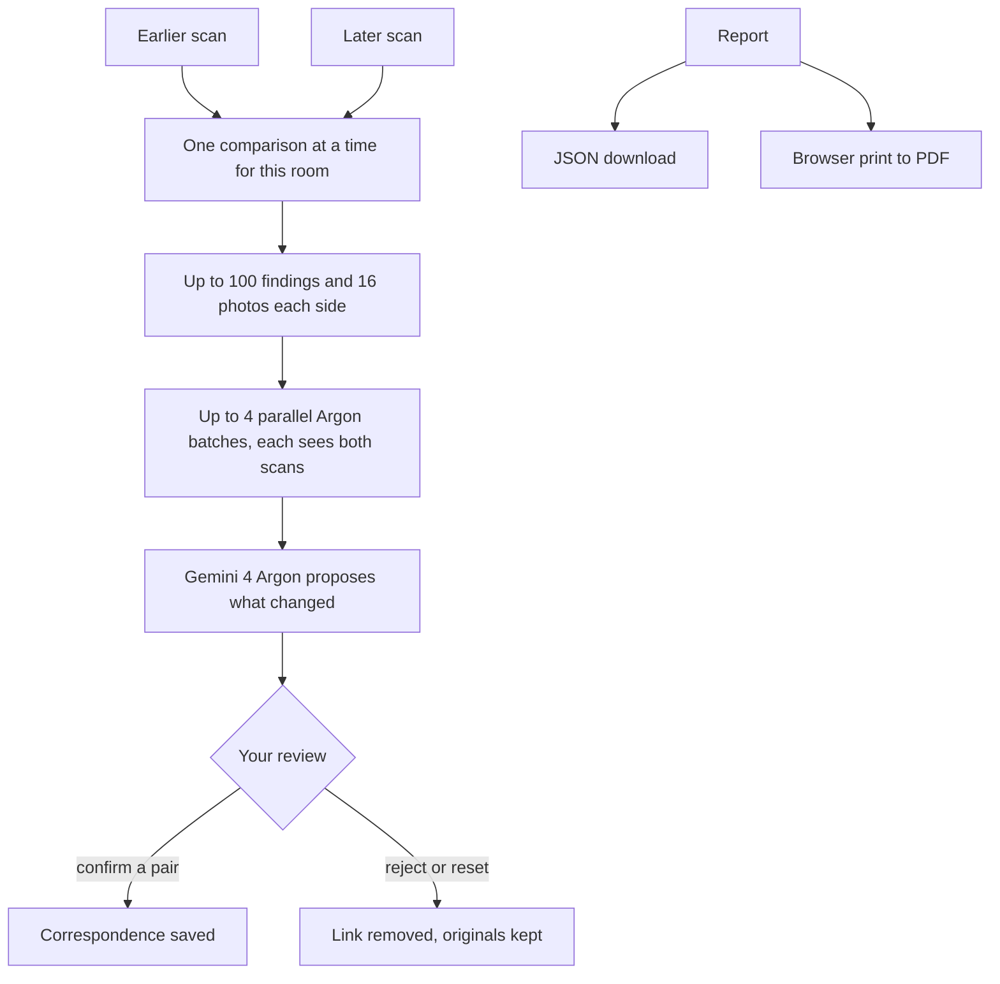

The API requires distinct owned inspections of the same room, an earlier baseline, a later current inspection, and `completed`/`partial` status. The intended workflow is move-in/move-out review; validation checks chronology rather than requiring specific type labels.

Comparison considers up to 100 non-rejected observations and 16 distinct evidence frames per side (`COMPARE_IMAGES_PER_SIDE` in `lib/server/comparison.ts`). The targets are split into up to four batches that run in parallel with `thinking_level` high; every batch receives both scans' full image context but only reports on its own targets, and results are merged and de-duplicated by damage identity. Progress is shown per batch. Missing evidence can be supplemented from original recordings/native RGB frames, labelled as views rather than detections. Source and model-image hashes are retained.

Gemini proposes `pre_existing`, `potentially_new`, `missing_or_changed`, `no_longer_visible`, `uncertain`, or `unchanged` candidates. Parsing constrains finding IDs and comparable-view claims. Review history is appended; confirming a two-sided candidate activates a correspondence, while rejection/reset deactivates it transactionally. Originals remain separate. Visual comparison does not register independent scan coordinates or establish legal responsibility.

### Reports

Schema version 1 JSON includes inspection metadata, non-rejected inventory, confirmed damage, pending damage, coordinates/timestamps, source provenance, evidence endpoints, and limitations. The report page provides JSON download and browser print/save-to-PDF.

Print export waits for confirmed evidence images and reports failures. JSON evidence URLs remain authenticated same-origin endpoints: an export is not a public media share link or self-contained offline evidence archive. PDF export uses the browser, not a backend PDF-rendering service.

## Pages and APIs

### Pages

| Route | Purpose |
| --- | --- |
| `/` | Dashboard and saved records. |
| `/sign-in`, `/profile` | Account access/profile. |
| `/rooms/[roomId]` | Room history. |
| `/rooms/[roomId]/compare` | Baseline/current comparison. |
| `/live`, `/live/[sessionId]` | New/active capture workspace. |
| `/connect/[sessionId]`, `/scan/[sessionId]` | Native QR handoff. |
| `/inspections/[inspectionId]` | Findings/evidence review. |
| `/inspections/[inspectionId]/spatial` | Geometry, reconstruction, markers. |
| `/inspections/[inspectionId]/report` | Printable report/export. |

### Account-authenticated APIs

See route handlers for exact schemas. Path IDs generally refer to MongoDB records.

| Methods | Endpoint | Purpose |
| --- | --- | --- |
| GET, POST | `/api/auth/[...all]` | Better Auth operations. |
| GET, POST | `/api/rooms` | List/create rooms. |
| GET, PATCH | `/api/rooms/[roomId]` | Read/rename room. |
| GET | `/api/rooms/[roomId]/correspondences` | Active reviewed links. |
| GET, POST | `/api/inspections` | List inspections; submit video analysis. |
| GET | `/api/inspections/[inspectionId]` | Inspection and findings. |
| GET | `/api/inspections/[inspectionId]/video` | Original recording stream. |
| POST | `/api/inspections/[inspectionId]/findings` | Manual damage using saved evidence. |
| PATCH | `/api/inspections/[inspectionId]/findings/[findingId]` | Review/update finding. |
| GET | `/api/inspections/[inspectionId]/report` | Report; `?download=1` adds attachment headers. |
| POST, PATCH | `/api/uploads` | Initialize/complete; append binary parts with `uploadId`/`part`. |
| GET | `/api/media?url=gridfs:...` | Private saved evidence. |
| POST | `/api/spatial/inspections` | Create native inspection awaiting capture. |
| GET, POST, PATCH | `/api/inspections/[inspectionId]/spatial` | Read/save manifest; attach/replace reconstruction. |
| GET | `/api/inspections/[inspectionId]/spatial/assets/[assetId]` | Private spatial asset. |
| POST | `/api/inspections/[inspectionId]/spatial/markers` | Create/move/review/delete markers with version checks. |
| GET, POST | `/api/comparisons` | List/generate comparison. |
| GET, PATCH | `/api/comparisons/[comparisonId]` | Read/review comparison. |
| GET, POST | `/api/search` | Search with `q`, `mode`, optional `roomId`; index own findings. |
| POST | `/api/ask` | Cited answer about saved records. |
| POST | `/api/live` | Create owned session. |

### Session APIs

Base path: `/api/live/[sessionId]`. Apart from pairing, these use role-scoped desktop/phone bearer capabilities.

| Methods | Suffix | Purpose |
| --- | --- | --- |
| POST | `/pair` | Redeem pairing token with phone token/device ID. |
| GET | Base path | Session, objects, findings, recipient signals. |
| POST | `/signal` | Offer/answer/ICE/restart. |
| POST | `/events` | Inventory, status/stop, reviews. |
| POST | `/analyze` | Phone image analysis/manual evidence. |
| POST, PATCH | `/upload` | Session-scoped chunked uploads. |
| GET | `/media?ref=gridfs:...` | Session evidence/video. |
| POST | `/finish` | Finalize browser video inspection. |
| PUT, POST | `/spatial` | Native progress/preview; commit manifest. |

## Deployment and operations

1. Import as a Next.js project on Vercel, or use Node hosting capable of running the native dependencies.
2. Configure all required environment variables for the target environment. Set the exact production origin for `BETTER_AUTH_URL`; local secrets are not inherited automatically.
3. Configure Atlas network access, permissions, and current search indexes.
4. Verify hosting duration/memory support. Several upload/analysis routes declare 300 seconds, but the hosting environment must actually support the workload. `after()` is not durable execution.
5. Preserve model/runtime assets. `next.config.ts` externalizes `ffmpeg-static`/`onnxruntime-node` and adds route-specific output tracing for FFmpeg and ONNX files.
6. Verify room creation → upload/capture → evidence → review → reopen → search → report, including second-account access denial.
7. For native pairing, install a signed companion on supported hardware and use the same HTTPS deployment. Configure genuine Apple distribution separately.

MongoDB coordinates live state across serverless instances. A cached Mongo client promise reuses per-instance connections with a pool of ten and bounded connection timeouts; failed connection attempts clear the cached promise for retry.

FFmpeg extraction uses temporary local files cleaned by the frame service. Large media/models consume server memory, and local captures consume phone storage. There is no provisioned GPU trainer, general durable-job recovery, or complete-media garbage collector.

`lib/server/api-error.ts` maps operational errors to sanitized responses/request IDs. Use request IDs to investigate server logs without exposing credentials, capabilities, SDP, or footage.

## Verification and troubleshooting

```sh
npm run lint
npm test
npm run build
```

`lint` runs TypeScript checking (`tsc --noEmit`), not ESLint. Tests use Node's built-in runner on `tests/*.test.cjs`. Coverage includes detector geometry/decoding, crop coordinates, furniture parsing, partial analysis, frame extraction, spatial validation/identity, comparisons, live tracking/signalling/session invariants, request bounds, and error/database diagnostics.

Tests do not establish model accuracy, physical LiDAR quality, or cross-network connectivity. [Historical verification records](docs/testing) document real Atlas/Gemini/browser probes in specific environments; some predate authentication or native-only handoff and are not fresh production certification.

Native docs record compilation, while actual capture quality, compact-upload latency, preview appearance, end-to-end native upload, and trained reconstruction still require physical-device/workstation verification. No public installer is configured.

| Symptom | Checks |
| --- | --- |
| Authentication fails | Secret length, Atlas connectivity, exact auth origin/port; restart after environment changes. |
| Database unavailable | URI escaping, network rules, permissions, database name. |
| Search unavailable | Index queryability and current owner/room/vector mappings. |
| Missing semantic results | Resume indexing, verify embedding access, allow index propagation. |
| Video decoding fails | Try a short browser-decodable MP4; accepted MIME does not guarantee browser codec support. |
| Model assets fail | Verify `/models/` and `/onnx/` deployment assets. |
| `partial` inspection | Read warnings and inspect retained evidence; incomplete checks are not negative findings. |
| Stuck `processing` | Inspect logs and hosting termination/time budgets; no durable retry queue exists. |
| Upload 409 | Ensure sequential parts, identical retry bytes, and completed finalization. |
| QR cannot open app | Install through Xcode or retry a fresh pairing QR; installer URL is unset. |
| Slow 3D preview | Dashboard shows measured geometry first. Open the inspection for the full splat; check PLY size, asset network timing, GPU support and console errors. |
| Misaligned splats/markers | Check registration, image dimensions/intrinsics, sensor tracking and coordinate conventions. |
| Retained WebRTC fails | Check connection diagnostics and compatible TURN setup. |
| Report images missing | Maintain authentication and wait for evidence loading before print. |

## Models, licensing, and documentation

YOLO11n is vendored with provenance and notices; it names furniture in uploaded videos (browser) and in direct capture imports (server).

YOLO-related materials carry AGPL-3.0 terms, including network-use obligations described in their notices; no proprietary model licence is documented. Preserve applicable model/runtime notices. The offline guide documents separate gsplat/COLMAP/Three.js/GaussianSplats3D licensing. A repository-wide application license is not present.

| Guide | Contents |
| --- | --- |
| [Object model](public/models/README.md) | Export, checksum, classes, browser inference evidence, licensing. |
| [ONNX runtime](public/onnx/README.md) | Browser runtime assets and notices. |
| [Native companion](ios/README.md) | Xcode setup, capture, privacy. Read alongside newer compact/handoff guides. |
| [Compact LiDAR upload](docs/lidar-compact-upload.md) | Current preview, selected uploads, local originals, Metal display. |
| [Native handoff](docs/native-install-handoff.md) | Native-only QR flow and distribution limits. |
| [Offline reconstruction](scripts/spatial/README.md) | CUDA/COLMAP/gsplat training and registration. |
| [Profiles/search](docs/profile-and-search.md) | Auth, indexes, ownership migration, verification notes. |
| [Live protocol](docs/live/session-protocol.md) | Capability/signalling/lease details; older unauthenticated/browser-fallback statements are superseded. |
| [Spatial research](docs/research/lidar-roomplan.md) | Sensor/reconstruction background. |
| [Verification records](docs/testing) | Individual checks and their limitations. |
| [Pitch and demo plan](PITCH.md) | Storyline, how each bounty criterion is met, video shot list, deck. |
| [Bounty requirements](docs/BOUNTY-REQUIREMENTS.md) | Encode London 2026 rules for each track we entered. |
| [Performance and hackathon audit](docs/hackathon-performance-audit-2026.md) | 3D loading path, remaining benchmarks, partner requirements and demo checklist. |
