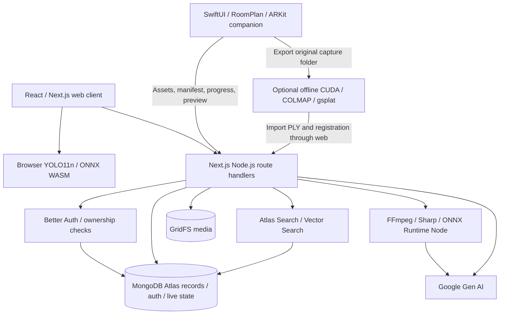
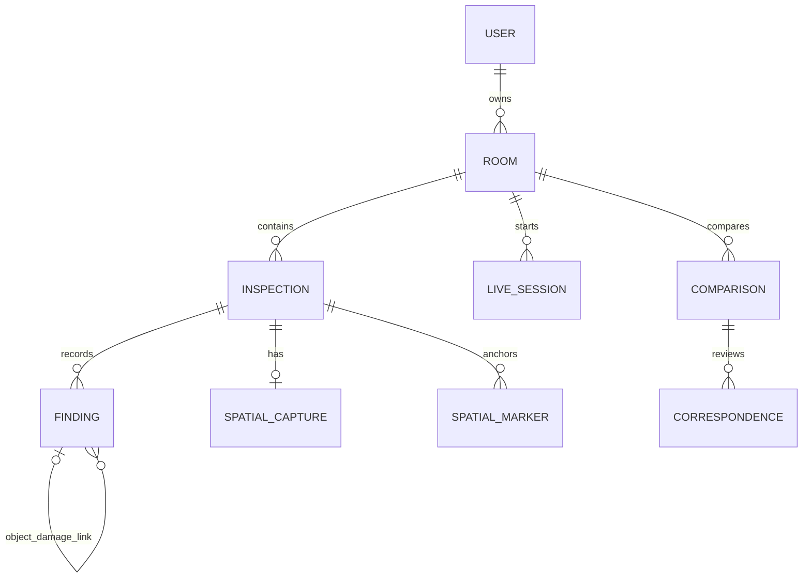

# dwelld.

**Your room remembers.**

Dwelld helps renters create a timestamped, reviewable record of a room's visible condition. It combines uploaded video or native LiDAR capture, object detection, AI damage observations, saved evidence, and comparisons between move-in and move-out inspections. Users can review observations, add manual evidence, search their records, and export reports.

This README describes the source and current working tree inspected on **23 October 2026**. Some documents in `docs/` describe earlier designs and verification snapshots; current code takes precedence where they conflict.

## Contents

- [Features and limitations](#features-and-limitations)
- [System architecture](#system-architecture)
- [Repository layout](#repository-layout)
- [Requirements and setup](#requirements-and-setup)
- [Environment variables](#environment-variables)
- [Capture and analysis](#capture-and-analysis)
- [Persistence and media](#persistence-and-media)
- [Authentication and authorization](#authentication-and-authorization)
- [Search and questions about records](#search-and-questions-about-records)
- [Comparisons and reports](#comparisons-and-reports)
- [Pages and APIs](#pages-and-apis)
- [Deployment and operations](#deployment-and-operations)
- [Verification and troubleshooting](#verification-and-troubleshooting)
- [Models, licensing, and documentation](#models-licensing-and-documentation)

## Features and limitations

| Area | Implemented behavior |
| --- | --- |
| Accounts | Better Auth email/password accounts and owner-scoped records. |
| Rooms | Create/rename rooms and reopen inspection history. |
| Video inspection | Upload recordings, detect furniture/fixtures on sampled frames, and save damage observations with timestamped evidence. |
| Native capture | SwiftUI companion uses RoomPlan/ARKit for measured elements, calibrated imagery, and available scene depth/confidence. |
| Pairing | A signed-in owner creates a laptop session; a QR handoff opens the native companion. |
| Spatial review | Three.js measured geometry, Gaussian preview/reconstruction, evidence-linked markers, and marker editing. |
| Human review | Confirm/reject/reset observations, preserve review history, and add manual damage evidence. |
| Comparison | Review candidate correspondences and visible changes between earlier and later inspections of the same room. |
| Retrieval | Atlas text, semantic, and hybrid search; source-cited answers about saved records. |
| Export | Structured JSON and browser print/save-to-PDF reports. |

AI observations require review. A missing detection or completed analysis does not establish absence of damage. A confirmed finding records a user's review decision; it does not determine liability, structural safety, or repair cost. Independent RoomPlan scans have independent origins and are not automatically registered.

The repository retains browser WebRTC capture/signalling infrastructure, but the **current public QR pages open the native LiDAR companion only**. They no longer expose the earlier browser-phone recording fallback. Uploaded video remains a separate web capture option.

## System architecture

The web application is a **Next.js App Router application** with React client interfaces and Node.js route handlers. The iOS companion is a separate client of the same HTTPS backend. MongoDB Atlas stores both records and binary media through GridFS. There is no separate worker server, WebSocket service, or hosted GPU trainer in this repository.



### Layers and responsibilities

| Layer | Technology | Responsibility |
| --- | --- | --- |
| Web UI | Next.js 15, React 19, TypeScript | Dashboard, capture, history, review, comparisons, reports. |
| Styling | CSS, Tailwind CSS 3, Lucide | Shared visual system and icons. |
| API | Next.js route handlers, Node.js | Authorization, validation, uploads, analysis orchestration, persistence. |
| Authentication | Better Auth + MongoDB adapter | Password accounts and cookie sessions. |
| Storage | MongoDB driver 7, Atlas, GridFS | Structured records and private original/evidence bytes. |
| Browser inference | YOLO11n, ONNX Runtime Web | Local object detection using CPU/WASM. |
| Server processing | FFmpeg, Sharp, ONNX Runtime Node | Frame extraction, normalization/crops, native-frame YOLO and specialized crack inference. |
| Generative AI | `@google/genai` | Damage observations, supplemental furniture, comparison, embeddings, answers. |
| Spatial display | Three.js, GaussianSplats3D | Measured room geometry, splats, spatial annotations. |
| Native app | SwiftUI, RoomPlan, ARKit, Metal | LiDAR capture, calibrated evidence, depth-based Gaussian preview, upload. |
| Hosting/analytics | Vercel-compatible Next.js, Vercel Analytics | UI and functions; analytics mounted in the root layout. |
| Optional reconstruction | Python, COLMAP, pinned gsplat | Offline trained Gaussian reconstruction on a separate CUDA workstation. |

Versions above describe dependency families in `package.json`; `package-lock.json` pins the installed graph.

### Execution model

`app/api/` contains HTTP orchestration. Reusable services live in `lib/server/`, while browser inference, uploads, tracking, and signalling live in `lib/client/`. Shared contracts are in `lib/types.ts`, `lib/live/`, and `lib/spatial/`.

Video creation persists an inspection and returns its ID before running analysis with Next.js `after()`. Native manifest submission also schedules analysis with `after()`. This is function-lifetime background work, **not a durable job queue**: process termination can leave work unfinished. Comparison generation runs within the request, protected by a database lease per owner/room.

## Repository layout

```text
app/
  api/
    auth/[...all]/             Better Auth handler
    rooms/                     Owned rooms and correspondence history
    inspections/               Findings, video, reports, spatial capture
    spatial/inspections/       Create native-only inspection
    live/                      Pairing, signals, events, uploads, analysis
    comparisons/               Comparison generation and review
    uploads/, media/           Chunked upload and private streaming
    search/, ask/              Retrieval and cited answers
  rooms/[roomId]/              Room history and comparison pages
  inspections/[inspectionId]/  Inspection, spatial, and report pages
  live/                       Capture workspace and session page
  connect/, scan/              Native QR handoff (scan is a legacy URL)
  sign-in/, profile/          Account UI
components/                   Dashboard, capture, review, search, spatial UI
  live/                       Session workspace and feed
lib/
  auth.ts, auth-client.ts     Server/client auth configuration
  api.ts, types.ts            API client and record contracts
  client/                    Browser inference, tracking, upload, signalling
  server/                    Database, media, analysis, search, access
  live/                      Session and analysis contracts
  spatial/                   Manifest types, projection, identity association
  native-distribution.ts     Apple installation URL, currently unset
ios/                         Xcode project and native companion
public/models/               ONNX weights, provenance, licenses
public/onnx/                 Browser runtime assets and notices
scripts/
  setup-search-indexes.cjs    Submit Atlas text/vector indexes
  assign-legacy-owner.cjs     Audited legacy ownership migration
  spatial/                   Offline reconstruction wrapper
tests/                       Node regression suite
docs/                        Feature guides and historical verification
```

## Requirements and setup

- Node.js **20.19+** or a newer compatible release, and npm. The MongoDB driver's engine requirement is stricter than a generic Node 20 minimum.
- MongoDB Atlas access. Search/Vector Search support is needed for retrieval; comparison review and legacy migration use transactions.
- A Google Gen AI key with access to the configured generation model and, for semantic retrieval, `gemini-embedding-001`.
- A modern browser with WebAssembly and video decoding support. Browser camera code requires permission and a secure context such as HTTPS or localhost.
- Native capture: Xcode, Apple signing, and a physical LiDAR-capable iPhone/iPad running iOS 17+. Simulator builds do not verify sensor capture.
- Optional trained reconstruction: a separate CUDA workstation with dependencies from the [reconstruction guide](scripts/spatial/README.md).

```sh
npm ci
cp .env.example .env.local
openssl rand -base64 32
```

Populate `.env.local`, using the generated value as `BETTER_AUTH_SECRET`. Start on port 3001 to match the authentication example:

```sh
npm run dev -- --port 3001
```

Open [localhost:3001](http://localhost:3001), create an account and room, then start a capture or upload. To use port 3000, set `BETTER_AUTH_URL=http://localhost:3000` and run `npm run dev`.

For a local production build:

```sh
npm run build
npm run start -- --port 3001
```

### Atlas configuration

1. Create a database user and allow network access from development/hosting environments.
2. Set `MONGODB_URI` and `MONGODB_DB`. URL-encode special characters in the database password.
3. Core/auth/upload/live indexes are created by their respective services. Atlas Search indexes require a separate setup step.
4. Submit current search definitions using a user with index-management privileges:

   ```sh
   node --env-file=.env.local scripts/setup-search-indexes.cjs
   ```

5. Wait until `findings_search` and `findings_vector` are queryable in Atlas. Index submission and propagation are asynchronous.

Use the setup script as the current index definition, including ownership filters; older search documents may describe previous mappings.

## Environment variables

Keep secrets in ignored environment files or deployment configuration. Gemini/MongoDB/auth secrets remain server-side and must not use `NEXT_PUBLIC_` names. **No Vercel Blob credentials are required.**

| Variable | Requirement | Purpose/default |
| --- | --- | --- |
| `MONGODB_URI` | Required | Records, authentication, live state, and GridFS connection. |
| `MONGODB_DB` | Optional | Database name; defaults to `dwelld`. |
| `BETTER_AUTH_SECRET` | Required | Random secret of at least 32 characters. |
| `BETTER_AUTH_URL` | Configure per environment | Exact origin, including local port; example uses `http://localhost:3001`. |
| `GEMINI_API_KEY` | AI features | Server-side generation and embedding credential. |
| `GEMINI_MODEL` | Optional override | Generation model; source/example default is `gemini-4-argon`. Verify access in your project; a configured identifier does not establish availability. |
| `TURN_URLS` | Optional WebRTC path | Comma-separated `turn:`/`turns:` endpoints. |
| `TURN_SHARED_SECRET` | Optional WebRTC path | TURN REST HMAC secret for a compatible provider. |
| `DWELLD_DIST_DIR` | Optional | Next.js output directory, default `.next`; useful for separate development/build outputs. |

The embedding model and 768 dimensions are defined in `lib/server/search.ts`, not an environment variable. Changing them requires compatible stored vectors and Atlas index configuration.

## Capture and analysis

### Uploaded video

```mermaid
sequenceDiagram
    participant B as Browser
    participant A as Next.js API
    participant M as MongoDB / GridFS
    participant G as Gemini
    B->>B: Decode video; YOLO at 15%, 50%, 85%
    B->>A: Initialize, upload sequential parts, complete
    A->>M: Assemble validated original video
    B->>A: Submit media reference and detection frames
    A->>M: Save processing inspection
    A-->>B: Inspection ID
    Note over A,G: after() work within function lifetime
    A->>A: FFmpeg extracts original-resolution frames
    A->>G: Object crops, furniture fallback, surfaces
    A->>A: Specialized crack inference
    A->>M: Evidence, findings, embeddings, warnings, status
    B->>A: Reopen/poll and review
```

1. The browser samples unique timestamps at 15%, 50%, and 85% of duration. Server validation accepts one to three frames and up to 20 detections per frame.
2. YOLO applies 640×640 letterboxing and class-aware non-maximum suppression, then maps boxes to normalized source coordinates. Browser detections are validated; this path does not independently rerun server YOLO against the uploaded recording.
3. FFmpeg extracts matching original-resolution PNGs. Identical frames are deduplicated by hash.
4. Gemini inspects detected-object crops in bounded batches. Crop-local damage coordinates map into the original frame. Damage links to specific object IDs rather than labels alone.
5. This path also asks Gemini for up to four supplemental objects per frame from wardrobe, bookshelf, desk, chest of drawers, sideboard, and nightstand. Invalid/overlapping proposals are discarded and provenance remains distinct from YOLO.
6. Whole-frame checks inspect room surfaces. A specialized crack model adds separately attributed candidate boxes.
7. Findings and evidence are saved with review status `pending`. Embeddings are indexed in a bounded batch; failed indexing can be resumed separately.

The working analysis budget is approximately 240 seconds within a route declaring `maxDuration=300`. Gemini damage calls have 45-second timeouts; selected transient errors receive one bounded retry if time remains. Incomplete checks preserve successful work as `partial` with explicit warnings. Fatal orchestration failures record `failed`.

Supported YOLO room classes are chair, couch, potted plant, bed, dining table, toilet, TV, laptop, microwave, oven, toaster, sink, refrigerator, clock, and vase. It is not open-vocabulary inventory. Repeated video views do not establish stable physical identity.

### Native LiDAR capture

The companion can scan locally before sign-in. Direct upload uses a web-account cookie acquired through its embedded browser and requires an owned room. Paired upload instead uses a scoped phone capability from a laptop session.

1. RoomPlan captures element UUIDs, dimensions, transforms, and a local USDZ. ARKit captures RGB frames, intrinsics, camera poses, and depth/confidence when available, at up to roughly 2 Hz and 240 frames over a scan bounded to 120 seconds.
2. The compact path builds an **untrained LiDAR-initialized Gaussian preview** from measured high-confidence depth. Samples deduplicate into 2.5 cm world voxels with a 150,000-splat cap. An on-device Metal preview renders up to 40,000 accumulated samples.
3. Compact upload sends the preview PLY, up to 24 resized JPEGs, corresponding depth/confidence assets, and a manifest. Up to four assets upload concurrently, each with sequential chunks; completed references persist for retry.
4. The backend validates the manifest and asset ownership. Paired assets must also belong to the session. Reposting the same saved manifest is idempotent; replacing it with a different scan is rejected.
5. Server analysis samples first/middle/last manifest frames and runs server-side YOLO. The shared live-image service checks up to three object crops plus surfaces/cracks per frame. Other detected objects remain inventory observations without individual damage checks.
6. High-confidence depth projects evidence into world coordinates. Compatible RoomPlan elements can group object observations within the scan; unresolved identity stays explicit. Marker creation preserves existing user edits.

World coordinates are ARKit right-handed, Y-up, in metres; matrices are column-major. Depth is little-endian float32 metres and confidence is uint8 0–2. Camera intrinsics must match encoded image dimensions. Stored registration does not itself prove good alignment.

**Compact upload does not back up the complete capture folder.** Full-resolution imagery, original depth/confidence, USDZ, and `original-manifest.json` remain in the app's Documents directory. Export the folder before uninstalling/deleting captures. Reopening saved capture folders after app restart is not yet implemented.

The Gaussian preview may contain gaps, blur, drift, and colour seams. Without usable depth the app retains measured geometry instead of inventing splats. A trained PLY with matching registration can later replace the initialized preview while retaining reconstruction history. Actual training requires the separate [offline workflow](scripts/spatial/README.md), not Vercel.

### Pairing and retained live infrastructure

`POST /api/live` checks the owner's room and creates a two-hour session with separate desktop and pairing capabilities. Pairing expires after ten minutes. MongoDB stores capability hashes; atomic claiming prevents a second phone from redeeming the pairing.

QR links use `/connect/[sessionId]` with the pairing token in the URL fragment. That page and legacy `/scan/[sessionId]` open `dwelld://pair`. The native companion sends refreshed JPEG previews and measured capture progress about every two seconds; this is not a native WebRTC stream.

`lib/native-distribution.ts` currently exports a null installer URL. A signed build must already be installed through Xcode. A real TestFlight/App Store link and production universal links remain distribution work. The handoff's 3.5-second fallback timer is not reliable installed-app detection. See [native installation handoff](docs/native-install-handoff.md).

The retained browser implementation uses direct WebRTC video/data, HTTP-polled MongoDB signalling, role-scoped bearer capabilities, idempotent event IDs, and negotiation generations. Phone sends offers; desktop sends answers. STUN is configured by default; restrictive networks may require compatible TURN credentials. Native previews do not depend on this relay path.

Live image analysis accepts at most three objects and a 3 MiB image, allows one AI request per session at a time, and applies a 15-second cooldown. Manual evidence has an independent lease and does not call Gemini. Browser-recording finalization waits for analysis/manual leases, requires saved original footage, and uses stable IDs for repeated finish requests. Native capture finalizes through its spatial-manifest endpoint instead.

## Persistence and media



These are logical relationships, enforced by application validation rather than relational foreign keys.

| Collection/group | Main contents |
| --- | --- |
| `user`, `session`, `account`, auth-managed collections | Better Auth identities, accounts/password hashes, sessions, rate-limit data. |
| `rooms` | Owner, name, timestamps. |
| `inspections` | Owner/room, move-in/move-out type, capture/source metadata, status, warnings, duration, timestamps. |
| `findings` | Object/damage kind, description, timestamp, evidence, normalized box/point, parent object, provenance, reviews/history, optional embedding/spatial observations. |
| `spatialCaptures` | One manifest per inspection; elements, calibrated frames, assets, reconstruction registration/history. |
| `spatialMarkers` | World positions, finding/element links, review history, optimistic version, soft deletion. |
| `comparisons` | Baseline/current evidence, candidates, model/prompt version, evidence hashes, warnings, reviews. |
| `observationCorrespondences` | Revocable links activated by confirmed comparison reviews. |
| `comparisonLeases` | Application lease serializing comparisons per owner/room. |
| `liveSessions`, `liveSignals`, `liveEvents` | Pairing/status/capability hashes, recipient-scoped signals, idempotent events. |
| `liveObjects`, `liveFindings`, `liveAnalyses`, `liveEvidence` | Tracking observations, reviews, analysis results, session evidence. |
| `mediaUploads`, `mediaUploadParts` | Temporary upload descriptors/parts, digests, locks, expiry. |
| `media.files`, `media.chunks` | GridFS metadata and binary media. |
| `ownershipMigrations` | Explicit ownership migration audit, including affected records and counts. |

Inspection states are `queued`, `processing`, `completed`, `partial`, and `failed`. Persisted reviews use `pending`, `confirmed`, and `rejected`; internal analyzer output is normalized when persisted. Live session states are `pairing`, `connected`, `recording`, `stopping`, and `saved`.

### Upload and retention

Media references use `gridfs:<ObjectId>`. Uploads accept files up to **100 MiB**, split into sequential HTTP parts of at most **2 MiB**. Parts are insert-only, SHA-256 checked, and idempotent for identical retries. Finalization acquires a recoverable lock and streams validated parts into GridFS. GridFS uses 255 KiB storage chunks independently of upload-part size.

Upload descriptors/parts expire after 24 hours using TTL indexes. Signalling has TTL cleanup. Session expiry does not delete completed inspections. Original media/evidence have no general automatic retention or deletion workflow; expiring temporary records does not garbage-collect completed GridFS files.

Media routes authorize access before streaming, use `private, no-store`, and support single HTTP byte ranges for playback. Saved inspection/report evidence requires an account session; live media requires the appropriate capability and session association. Earlier external Blob assets are not automatically migrated or deleted. **MongoDB/GridFS is the active storage architecture.**

## Authentication and authorization

Better Auth stores accounts/sessions in the same database. Passwords must contain 12–128 characters. Sessions expire after seven days and update after one day; authentication rate limiting uses database storage. Session cookies are HttpOnly.

`lib/server/access.ts` centralizes signed-in access and owned room/inspection lookups. Account mutations reject cross-site Fetch Metadata and mismatched origins when supplied. Routes using `readJsonBody` enforce JSON content type, object shape, and streaming byte limits; binary/multipart routes have separate validation.

A GridFS reference is not a public-access credential. Native phone capabilities are scoped to the owner's live session and do not create a general account session.

Email verification and password-reset email delivery are not configured. Sign-up does not establish mailbox ownership. Ownerless historical demo records remain inaccessible and are never assigned automatically during signup.

To inspect an explicit migration dry run:

```sh
node --env-file=.env.local scripts/assign-legacy-owner.cjs --owner-id <existing-user-id>
```

Optionally add `--room-id <legacy-room-id>`. Only after auditing intended ownership, rerun with `--apply`. The script validates the user and conflicting ownership, then transactionally assigns ownerless rooms, inspections, findings, and referenced GridFS metadata with an audit record. It does not claim orphan files or live capabilities.

## Search and questions about records

| Mode | Implementation |
| --- | --- |
| `text` | Atlas `findings_search`, fuzzy label/description matching with owner/room filters. |
| `semantic` | Atlas `findings_vector`, 768-dimensional cosine vectors with owner/room prefilters and embedding-model checks. |
| `hybrid` | Both lists combined with reciprocal rank fusion, `k=60`. |

Embeddings use `gemini-embedding-001`, L2 normalization, `RETRIEVAL_DOCUMENT` for findings and `RETRIEVAL_QUERY` for queries. Indexing handles up to 50 findings per invocation. The search UI's **Index my findings** action resumes missing embeddings through `POST /api/search`.

Search checks required indexes are queryable and returns an explicit error when unavailable; there is no silent regex substitute for semantic search. Atlas propagation after embedding writes is asynchronous.

The global Ask Records interface supplies Gemini with up to 12 recent inspection summaries and 12 hybrid-retrieved findings. The API validates citation IDs and links sources back to inspections. If retrieval fails, it explicitly warns that only recent summaries were supplied. Answers are bounded retrieval samples, not exhaustive history or new image analysis.

## Comparisons and reports

### Comparison

The API requires distinct owned inspections of the same room, an earlier baseline, a later current inspection, and `completed`/`partial` status. The intended workflow is move-in/move-out review; validation checks chronology rather than requiring specific type labels.

Comparison considers up to 100 non-rejected observations and six distinct evidence frames per side. Missing evidence can be supplemented from original recordings/native RGB frames, labelled as views rather than detections. Source and model-image hashes are retained.

Gemini proposes `pre_existing`, `potentially_new`, `missing_or_changed`, `no_longer_visible`, `uncertain`, or `unchanged` candidates. Parsing constrains finding IDs and comparable-view claims. Review history is appended; confirming a two-sided candidate activates a correspondence, while rejection/reset deactivates it transactionally. Originals remain separate. Visual comparison does not register independent scan coordinates or establish legal responsibility.

### Reports

Schema version 1 JSON includes inspection metadata, non-rejected inventory, confirmed damage, pending damage, coordinates/timestamps, source provenance, evidence endpoints, and limitations. The report page provides JSON download and browser print/save-to-PDF.

Print export waits for confirmed evidence images and reports failures. JSON evidence URLs remain authenticated same-origin endpoints: an export is not a public media share link or self-contained offline evidence archive. PDF export uses the browser, not a backend PDF-rendering service.

## Pages and APIs

### Pages

| Route | Purpose |
| --- | --- |
| `/` | Dashboard and saved records. |
| `/sign-in`, `/profile` | Account access/profile. |
| `/rooms/[roomId]` | Room history. |
| `/rooms/[roomId]/compare` | Baseline/current comparison. |
| `/live`, `/live/[sessionId]` | New/active capture workspace. |
| `/connect/[sessionId]`, `/scan/[sessionId]` | Native QR handoff. |
| `/inspections/[inspectionId]` | Findings/evidence review. |
| `/inspections/[inspectionId]/spatial` | Geometry, reconstruction, markers. |
| `/inspections/[inspectionId]/report` | Printable report/export. |

### Account-authenticated APIs

See route handlers for exact schemas. Path IDs generally refer to MongoDB records.

| Methods | Endpoint | Purpose |
| --- | --- | --- |
| GET, POST | `/api/auth/[...all]` | Better Auth operations. |
| GET, POST | `/api/rooms` | List/create rooms. |
| GET, PATCH | `/api/rooms/[roomId]` | Read/rename room. |
| GET | `/api/rooms/[roomId]/correspondences` | Active reviewed links. |
| GET, POST | `/api/inspections` | List inspections; submit video analysis. |
| GET | `/api/inspections/[inspectionId]` | Inspection and findings. |
| GET | `/api/inspections/[inspectionId]/video` | Original recording stream. |
| POST | `/api/inspections/[inspectionId]/findings` | Manual damage using saved evidence. |
| PATCH | `/api/inspections/[inspectionId]/findings/[findingId]` | Review/update finding. |
| GET | `/api/inspections/[inspectionId]/report` | Report; `?download=1` adds attachment headers. |
| POST, PATCH | `/api/uploads` | Initialize/complete; append binary parts with `uploadId`/`part`. |
| GET | `/api/media?url=gridfs:...` | Private saved evidence. |
| POST | `/api/spatial/inspections` | Create native inspection awaiting capture. |
| GET, POST, PATCH | `/api/inspections/[inspectionId]/spatial` | Read/save manifest; attach/replace reconstruction. |
| GET | `/api/inspections/[inspectionId]/spatial/assets/[assetId]` | Private spatial asset. |
| POST | `/api/inspections/[inspectionId]/spatial/markers` | Create/move/review/delete markers with version checks. |
| GET, POST | `/api/comparisons` | List/generate comparison. |
| GET, PATCH | `/api/comparisons/[comparisonId]` | Read/review comparison. |
| GET, POST | `/api/search` | Search with `q`, `mode`, optional `roomId`; index own findings. |
| POST | `/api/ask` | Cited answer about saved records. |
| POST | `/api/live` | Create owned session. |

### Session APIs

Base path: `/api/live/[sessionId]`. Apart from pairing, these use role-scoped desktop/phone bearer capabilities.

| Methods | Suffix | Purpose |
| --- | --- | --- |
| POST | `/pair` | Redeem pairing token with phone token/device ID. |
| GET | Base path | Session, objects, findings, recipient signals. |
| POST | `/signal` | Offer/answer/ICE/restart. |
| POST | `/events` | Inventory, status/stop, reviews. |
| POST | `/analyze` | Phone image analysis/manual evidence. |
| POST, PATCH | `/upload` | Session-scoped chunked uploads. |
| GET | `/media?ref=gridfs:...` | Session evidence/video. |
| POST | `/finish` | Finalize browser video inspection. |
| PUT, POST | `/spatial` | Native progress/preview; commit manifest. |

## Deployment and operations

1. Import as a Next.js project on Vercel, or use Node hosting capable of running the native dependencies.
2. Configure all required environment variables for the target environment. Set the exact production origin for `BETTER_AUTH_URL`; local secrets are not inherited automatically.
3. Configure Atlas network access, permissions, and current search indexes.
4. Verify hosting duration/memory support. Several upload/analysis routes declare 300 seconds, but the hosting environment must actually support the workload. `after()` is not durable execution.
5. Preserve model/runtime assets. `next.config.ts` externalizes `ffmpeg-static`/`onnxruntime-node` and adds route-specific output tracing for FFmpeg and ONNX files.
6. Verify room creation → upload/capture → evidence → review → reopen → search → report, including second-account access denial.
7. For native pairing, install a signed companion on supported hardware and use the same HTTPS deployment. Configure genuine Apple distribution separately.

MongoDB coordinates live state across serverless instances. A cached Mongo client promise reuses per-instance connections with a pool of ten and bounded connection timeouts; failed connection attempts clear the cached promise for retry.

FFmpeg extraction uses temporary local files cleaned by the frame service. Large media/models consume server memory, and local captures consume phone storage. There is no provisioned GPU trainer, general durable-job recovery, or complete-media garbage collector.

`lib/server/api-error.ts` maps operational errors to sanitized responses/request IDs. Use request IDs to investigate server logs without exposing credentials, capabilities, SDP, or footage.

## Verification and troubleshooting

```sh
npm run lint
npm test
npm run build
```

`lint` runs TypeScript checking (`tsc --noEmit`), not ESLint. Tests use Node's built-in runner on `tests/*.test.cjs`. Coverage includes detector geometry/decoding, crack candidates, crop coordinates, furniture parsing, partial analysis, frame extraction, spatial validation/identity, comparisons, live tracking/signalling/session invariants, request bounds, and error/database diagnostics.

Tests do not establish model accuracy, physical LiDAR quality, or cross-network connectivity. [Historical verification records](docs/testing) document real Atlas/Gemini/browser probes in specific environments; some predate authentication or native-only handoff and are not fresh production certification.

Native docs record compilation, while actual capture quality, compact-upload latency, preview appearance, end-to-end native upload, and trained reconstruction still require physical-device/workstation verification. No public installer is configured.

| Symptom | Checks |
| --- | --- |
| Authentication fails | Secret length, Atlas connectivity, exact auth origin/port; restart after environment changes. |
| Database unavailable | URI escaping, network rules, permissions, database name. |
| Search unavailable | Index queryability and current owner/room/vector mappings. |
| Missing semantic results | Resume indexing, verify embedding access, allow index propagation. |
| Video decoding fails | Try a short browser-decodable MP4; accepted MIME does not guarantee browser codec support. |
| Model assets fail | Verify `/models/` and `/onnx/` deployment assets. |
| `partial` inspection | Read warnings and inspect retained evidence; incomplete checks are not negative findings. |
| Stuck `processing` | Inspect logs and hosting termination/time budgets; no durable retry queue exists. |
| Upload 409 | Ensure sequential parts, identical retry bytes, and completed finalization. |
| QR cannot open app | Install through Xcode or retry a fresh pairing QR; installer URL is unset. |
| Misaligned splats/markers | Check registration, image dimensions/intrinsics, sensor tracking and coordinate conventions. |
| Retained WebRTC fails | Check connection diagnostics and compatible TURN setup. |
| Report images missing | Maintain authentication and wait for evidence loading before print. |

## Models, licensing, and documentation

YOLO11n and a specialized YOLOv8n-seg crack model are vendored with provenance/notices. Crack inference uses bounding-box candidates, not segmentation masks or structural severity. High-resolution crack checks include overlapping crops mapped back to source coordinates. Scores are model outputs, not calibrated certainty.

YOLO-related materials carry AGPL-3.0 terms, including network-use obligations described in their notices; no proprietary model licence is documented. Preserve applicable model/runtime notices. The offline guide documents separate gsplat/COLMAP/Three.js/GaussianSplats3D licensing. A repository-wide application license is not present.

| Guide | Contents |
| --- | --- |
| [Object model](public/models/README.md) | Export, checksum, classes, browser inference evidence, licensing. |
| [Crack model](public/models/CRACK-MODEL.md) | Source revision/checksum, outputs, thresholds, limitations. |
| [ONNX runtime](public/onnx/README.md) | Browser runtime assets and notices. |
| [Native companion](ios/README.md) | Xcode setup, capture, privacy. Read alongside newer compact/handoff guides. |
| [Compact LiDAR upload](docs/lidar-compact-upload.md) | Current preview, selected uploads, local originals, Metal display. |
| [Native handoff](docs/native-install-handoff.md) | Native-only QR flow and distribution limits. |
| [Offline reconstruction](scripts/spatial/README.md) | CUDA/COLMAP/gsplat training and registration. |
| [Profiles/search](docs/profile-and-search.md) | Auth, indexes, ownership migration, verification notes. |
| [Live protocol](docs/live/session-protocol.md) | Capability/signalling/lease details; older unauthenticated/browser-fallback statements are superseded. |
| [Spatial research](docs/research/lidar-roomplan.md) | Sensor/reconstruction background. |
| [Verification records](docs/testing) | Individual checks and their limitations. |
